# Exercise 1 - Set Up the Payment Advice Schema and Process Your First Document

A **schema** is the central configuration object in SAP Document AI. It defines which fields the AI extracts from a document type, whether extraction is automatic or manual, and which workflows trigger after processing. Every document you upload is processed against a specific schema version.

SAP ships ready-made **content schemas** for common business document types. You enable one for your workspace, then trim it down to only the fields you actually need. In this exercise you will enable the Payment Advice schema, remove the granular address fields that add noise without value, and process your first document.

## Exercise 1.1 - Enable the Schema

1. On the home screen, click **Manage Schemas**.
 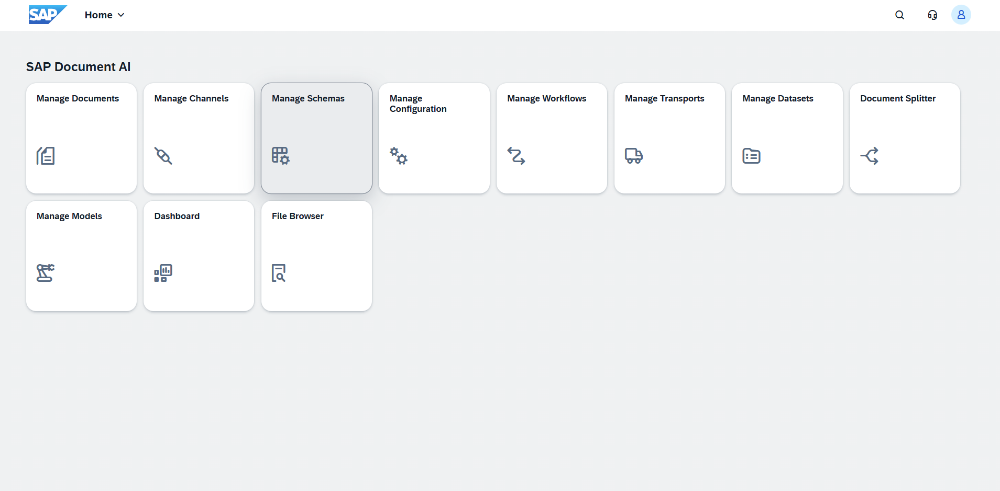

2. The schema list opens on the **All** tab. Switch to the **Content** tab to see SAP-delivered schemas.

3. Search for `PAYMENT_ADVICE`. Select the checkbox next to **PAYMENT_ADVICE_STANDARD** and click **Enable**.
 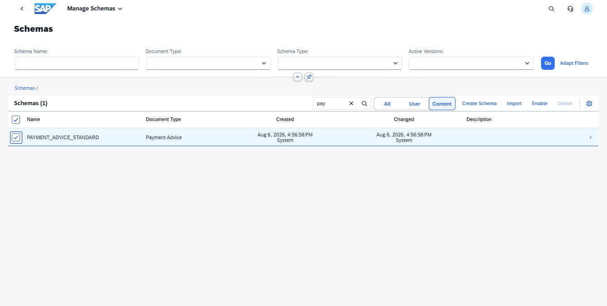

4. In the dialog, select version **1**, check **Activate immediately**, and click **Create**.
 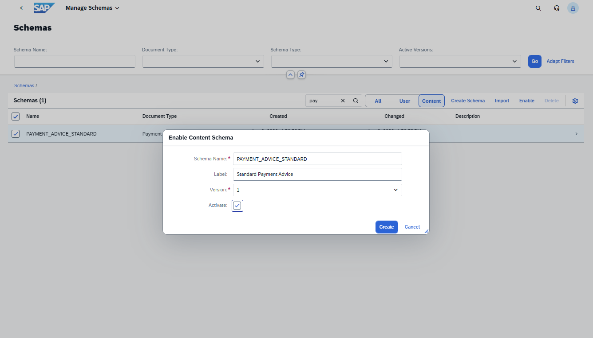

5. Switch to the **User** tab. The schema appears with status **Active**.
 

## Exercise 1.2 - Trim the Schema

The schema comes with a detailed `businessPartner` group containing many granular address sub-fields. For Payment Advice processing we only need the sender name and address — the rest adds noise. You will remove the unnecessary fields now.

1. Click **PAYMENT_ADVICE_STANDARD**, then **Version 1**.

2. The schema detail opens on the **Entities** tab. Take a moment to explore the other tabs — each controls a different aspect:

   - **Entities**: the fields the AI extracts. Each field has a name, data type, and field type (Extraction or Input).
   - **Processing Settings**: natural-language instructions that guide the AI per field. Used in Exercise 2.
   - **Automation**: confidence thresholds for automatic confirmation. Configured in Exercise 3.
   - **Notifications and Extensions**: links workflows that fire after processing. Configured in Exercise 6.
 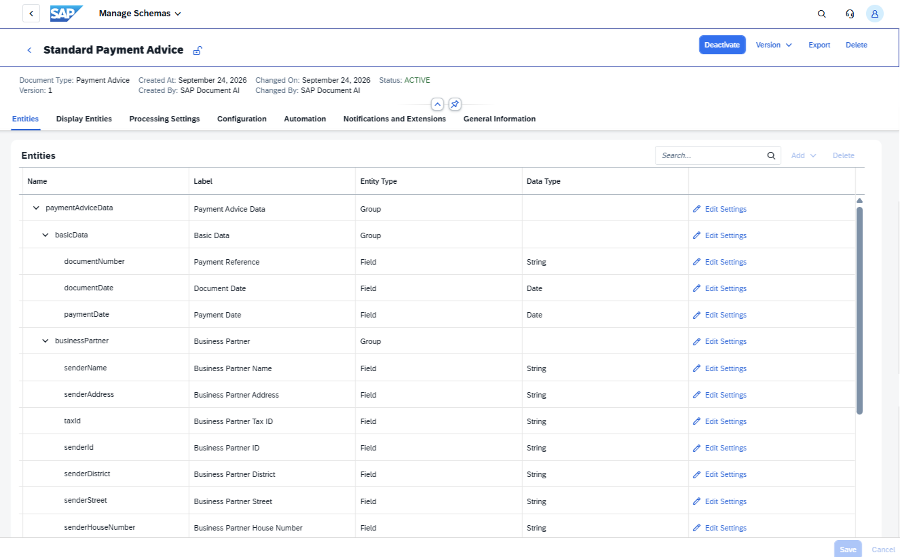

3. Click **Deactivate** to make the schema editable.

4. On the **Entities** tab, expand the **businessPartner** group. Select the checkboxes for all fields except `senderName`:
   - `senderAddress`
   - `taxId`
   - `senderId`
   - `senderDistrict`
   - `senderStreet`
   - `senderHouseNumber`
   - `senderPostalCode`
   - `senderCity`
   - `senderState`
   - `senderExtraAddressPart`
   - `senderCountryCode`

   Click **Delete**.
 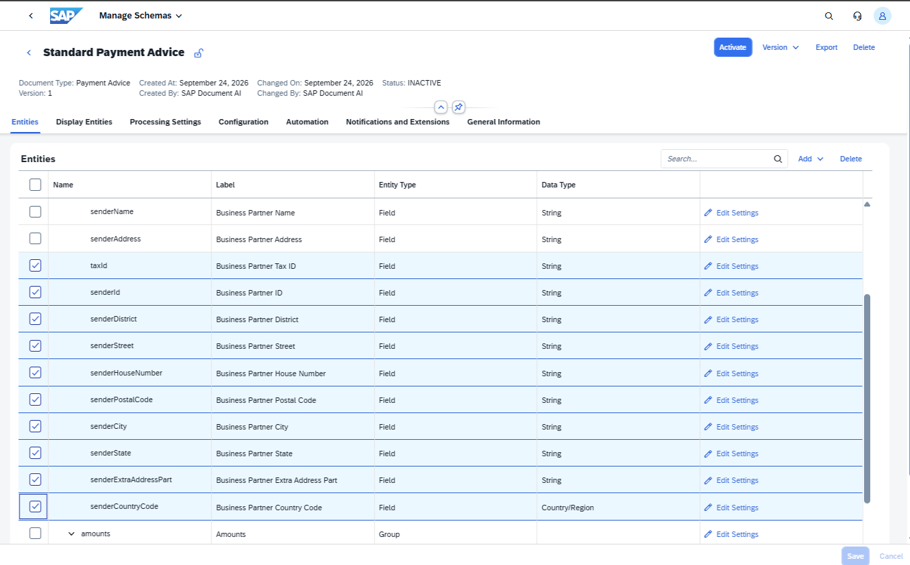

5. The group now contains only `senderName`. Click **Save**.
 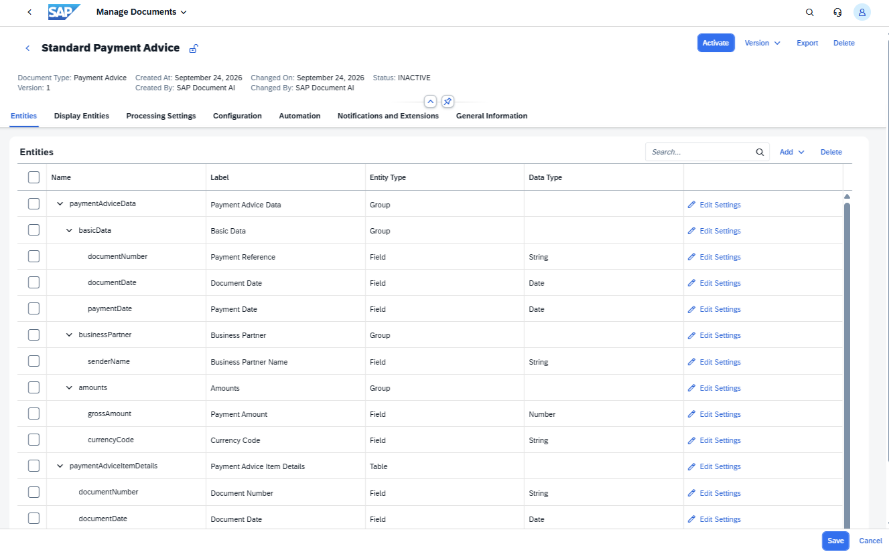

6. Click **Activate** to bring the schema back to **Active** status.

## Exercise 1.3 - Upload Your First Document

1. Navigate to the home screen and click **Manage Documents**.
 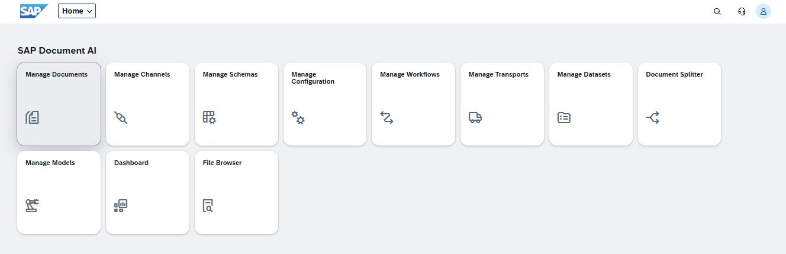

2. Set **Document Type** to `Payment Advice` and **Schema** to `PAYMENT_ADVICE_STANDARD`, then click **Go**.
 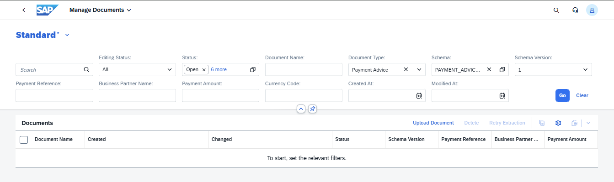

3. Click **Upload Document**, or drag and drop the file. In the upload dialog, set:

   | Field | Value |
   |---|---|
   | Document Type | `Payment Advice` |
   | Schema | `PAYMENT_ADVICE_STANDARD` |
   | Schema Version | `1` |

   Select `payment_advice_acme_jul2026.pdf` using **Browse** or drag it into the Documents area, then click **Upload**.
 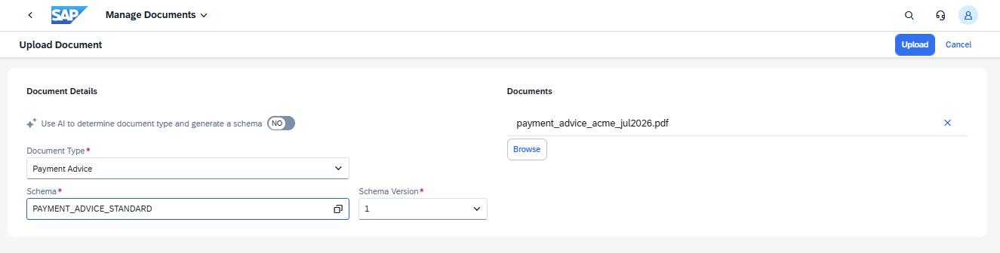

4. A new entry appears. Wait a few seconds until the status changes to **Review Needed**.
 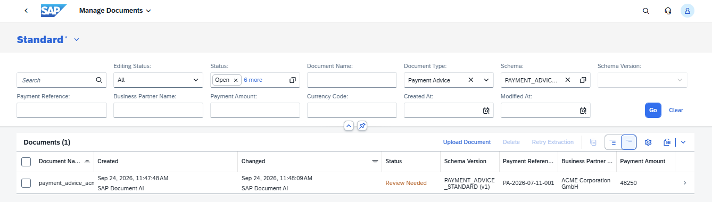

5. Click the document to open the review screen. On the left you see the document preview with extracted fields highlighted; on the right the field values with confidence indicators. Verify that key fields — total amount, payer name, payment reference — have been extracted correctly.
 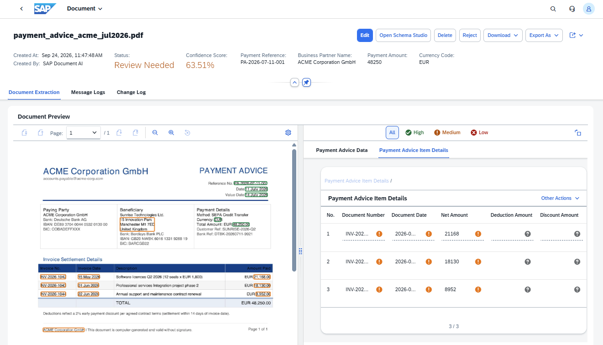

## Summary

You have enabled a content schema, trimmed it to the fields you need, and processed your first Payment Advice document. Continue to [Exercise 2](../ex2/README.md) to add a custom extraction field.
