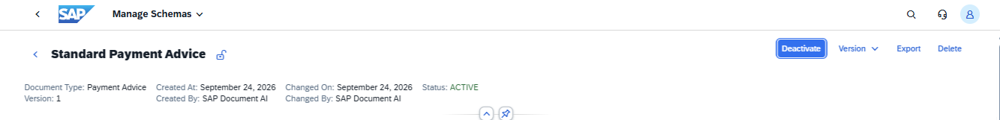
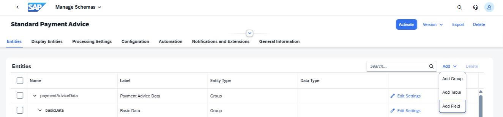
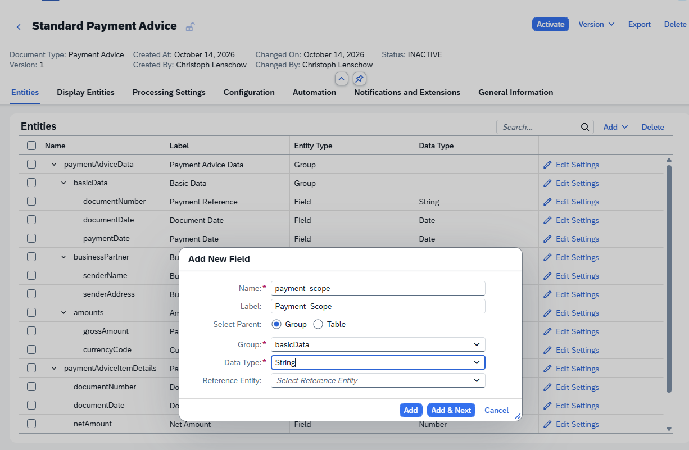
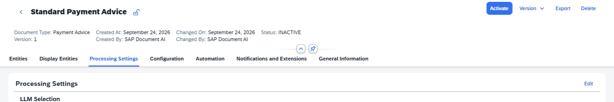
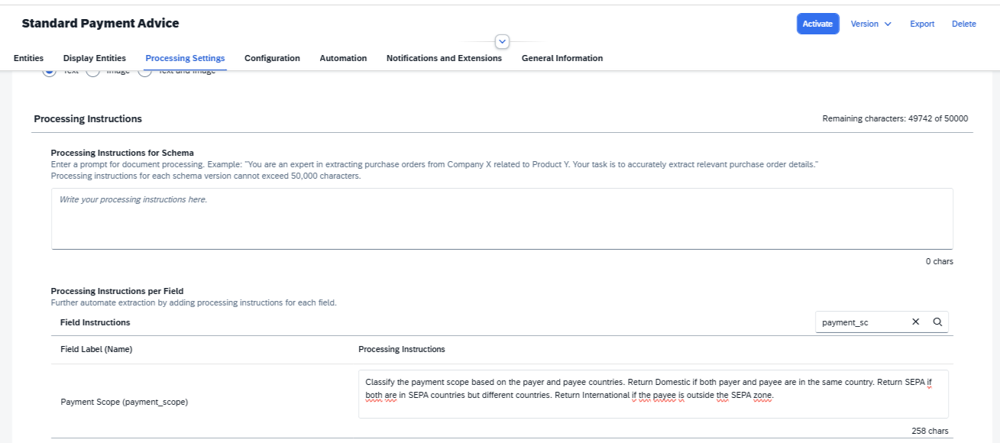
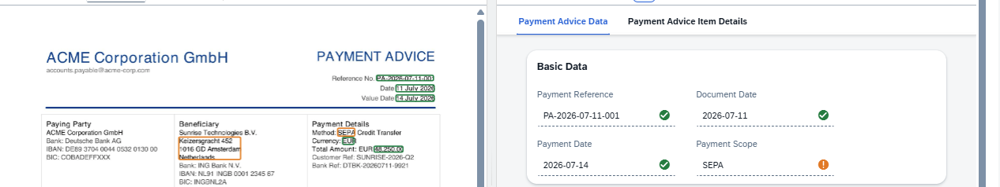

# Exercise 2 - Add a Custom Field with Processing Instructions

The standard Payment Advice schema extracts financial data but does not classify whether a payment is domestic or cross-border. In this exercise you will add a custom field and give the AI specific instructions for how to populate it.

## Exercise 2.1 - Deactivate the Schema for Editing

1. Open **PAYMENT_ADVICE_STANDARD** and click **Version 1**.

2. The schema is currently **Active**. Click **Deactivate** to make it editable.
 

## Exercise 2.2 - Add the Custom Field

1. On the **Entities** tab, click **Add**, then **Add Field**.
 

2. Fill in the dialog:

   | Field | Value |
   |---|---|
   | Name | `payment_scope` |
   | Label | `Payment Scope` |
   | Select Parent | **Group** |
   | Group | `basicData` |
   | Data Type | `String` |

   Click **Add**.
 

## Exercise 2.3 - Add Processing Instructions

1. Open the **Processing Settings** tab. The input fields are read-only. Click **Edit** to enable them.
 

2. Scroll down to the **Processing Instructions per Field** section. Search for `payment_scope` to find your new field. Enter the following text in the **Processing Instructions** box for **Payment Scope**:

   > Classify the payment scope based on the payer and payee countries. Return `Domestic` if both payer and payee are in the same country. Return `SEPA` if both are in SEPA countries but different countries. Return `International` if the payee is outside the SEPA zone.

   Click **Save**.
 

## Exercise 2.4 - Reactivate and Test

1. Click **Activate** to bring the schema back to **Active** status.

2. Navigate to **Manage Documents** and upload `payment_advice_acme_jul2026.pdf` again (ACME in Germany paying Sunrise in the Netherlands; expected result: `SEPA`).

3. Open the document. Find the **Payment Scope** field in the **Basic Data** section; it should show `SEPA`.
 

## Summary

You have extended a content schema with a custom field driven by natural-language processing instructions. Continue to [Exercise 3](../ex3/README.md) to review your extracted documents.
