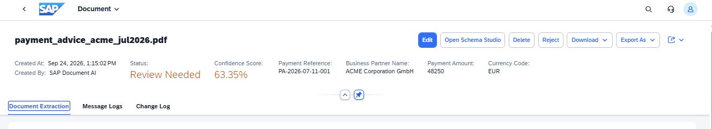
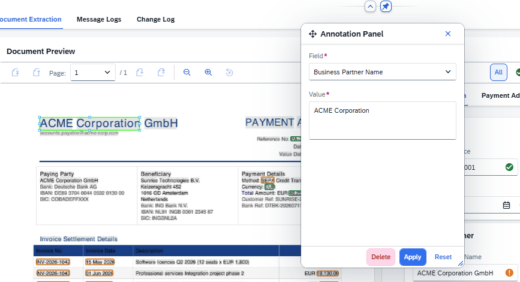
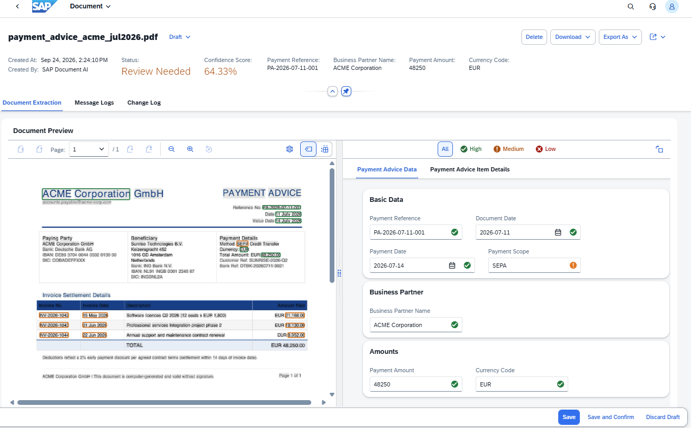
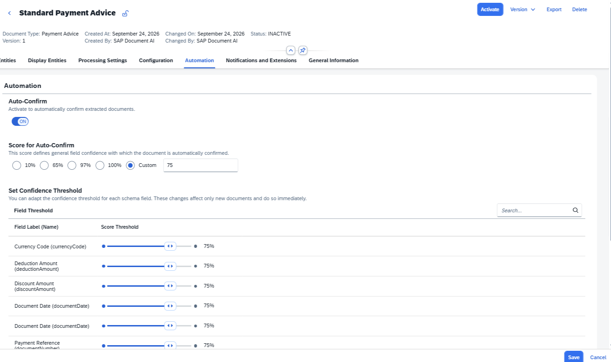

# Exercise 3 - Review Documents and Enable Automatic Confirmation

After consistent use, extraction results become reliable enough to skip manual review for high-confidence documents. In this exercise you will review and correct a document, then configure automatic confirmation based on AI confidence scores.

## Exercise 3.1 - Review and Correct a Document

1. Open **Manage Documents** for **PAYMENT_ADVICE_STANDARD**. If no document is in **Review Needed** state, upload `payment_advice_acme_jul2026.pdf`. Click the document row to open it.

   The document header shows the current status (**Review Needed**), the confidence score, and key extracted header fields. Click **Edit** to enter review mode.
 

2. The full review screen opens, showing the document preview on the left and the extracted field values on the right. Fields are grouped by section: **Basic Data**, **Business Partner**, and **Amounts**.

   To correct a value using the document preview: click the text directly in the PDF, then in the **Annotation Panel** select the target field from the dropdown, confirm or adjust the value, and click **Apply**.
 

3. Work through any fields flagged with a yellow or red confidence indicator. Once satisfied with all values, click **Save and Confirm**. The document status changes to **Confirmed**.
 

## Exercise 3.2 - Enable Automatic Confirmation

1. Navigate back to the schema detail for **PAYMENT_ADVICE_STANDARD**, Version 1. Deactivate if needed.

2. Open the **Automation** tab. Toggle **Auto-Confirm** to **ON**. Under **Score for Auto-Confirm**, select **Custom** and enter `75`. The per-field threshold table below updates all fields to 75%.
 

3. Optionally, use the **Set Confidence Threshold** table to raise the threshold for individual fields. For example, slide `paymentAmount` to **90%** to ensure the total is always verified before auto-confirming.

4. Click **Save**, then **Activate** the schema.

5. Upload `payment_advice_acme_jul2026.pdf` again. This time the document should skip **Review Needed** and land directly in **Confirmed**: all fields exceeded the 75% threshold.

## Summary

You have reviewed a document manually and configured automatic confirmation. In a production environment this eliminates repetitive review work for routine documents while keeping human oversight for low-confidence cases. Continue to [Exercise 4](../ex4/README.md) to build a workflow that processes emails.
