# Exercise 4 - Build a Basic Workflow for Email Processing

So far you have uploaded PDF files directly. In practice, Payment Advice documents often arrive by email with multiple attachments of mixed types. In this exercise you will build a workflow that unpacks an email, filters for PDF attachments only, and runs extraction on each one.

## Exercise 4.1 - Create the Workflow

1. From the home screen, click **Manage Workflows**.
 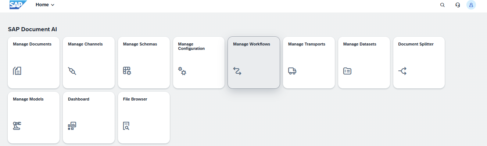

2. Click **Create** and fill in the dialog:

   | Field | Value |
   |---|---|
   | Name | `my_payment_basic` |
   | Label | `My Payment Basic Workflow` |
   | Type | **Basic** |

   Click **Create**.
 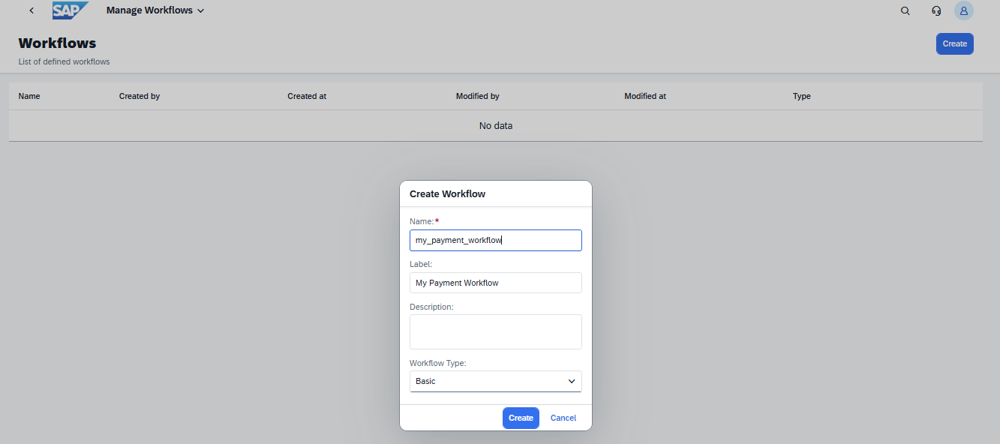

3. The workflow appears in the list. Click it to open it. The workflow canvas opens with a **Start** node and a **+** placeholder.

## Exercise 4.2 - Add an Email Split Node

1. Click the **+** after the Start node. The **Choose Your Next Step** panel opens. Select **Email Split**.
 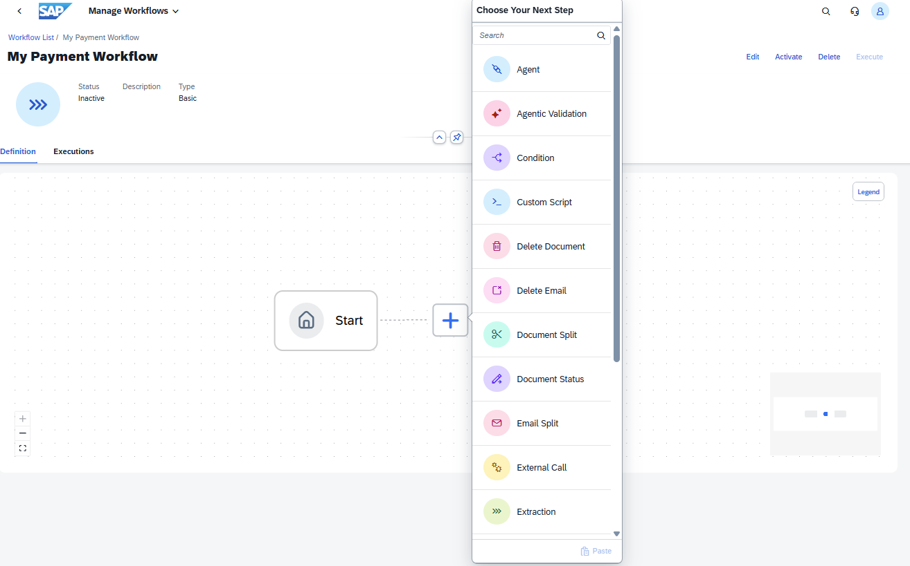

2. In the configuration panel, set:

   | Field | Value |
   |---|---|
   | Identifier | `email` |
   | Include Email Bodies | **Off** |

   Leave all other fields at their defaults. Click **Apply**.
 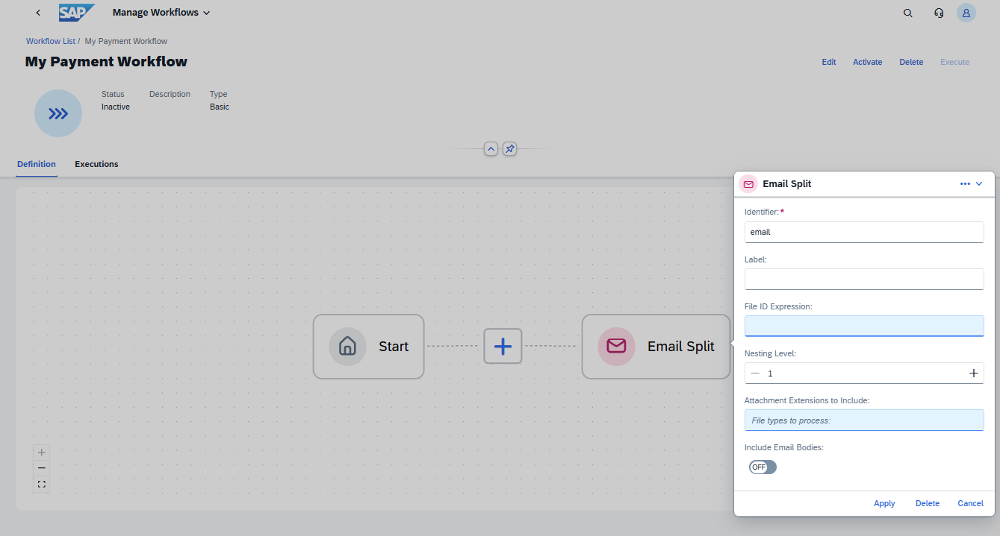

   Turning off **Include Email Bodies** means only attachments are passed downstream, not the email text itself.

## Exercise 4.3 - Add a ForEach Node

1. Click the **+** after the Email Split node and select **ForEach**. The node is added and its subworkflow canvas appears as a blue box.
 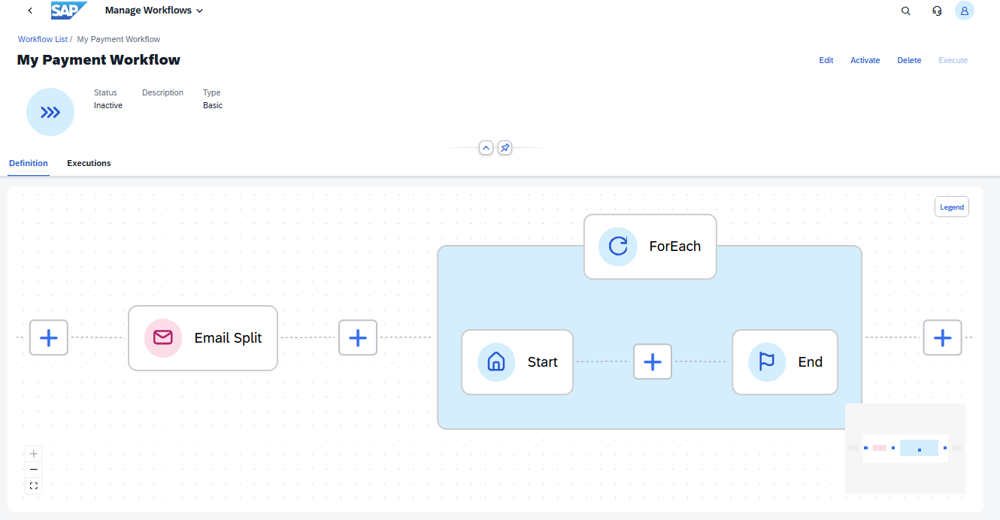

2. Click the **ForEach** node to open its configuration panel. Set:

   | Field | Value |
   |---|---|
   | Identifier | `loop` |
   | Iterator Expression | `email.getFileIds()` |

   Click **Apply**.
 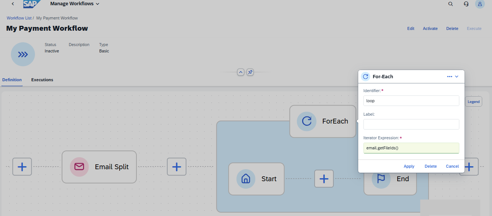

   This iterates over every file the Email Split node found. Inside the loop, the current file is available as `item`.

## Exercise 4.4 - Add a Condition Inside the Loop

1. Click the **+** inside the ForEach subworkflow (between Start and End) and select **Condition**.

2. In the configuration panel, set **Identifier** to `file_type_check`. Click **Apply**.
 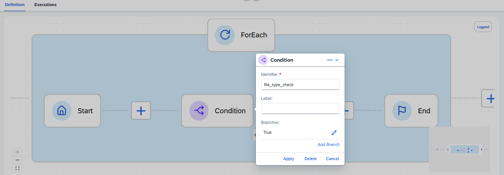

3. To set the branch expression, click the **pencil icon** next to the **True** branch. A context menu appears; click **Edit**.
 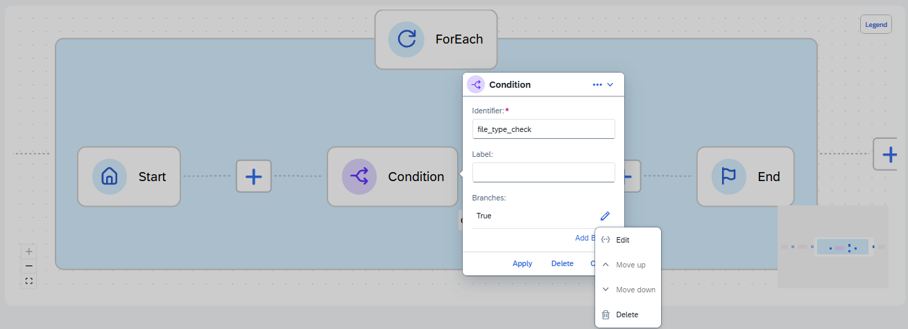

4. In the Edit dialog, set:

   | Field | Value |
   |---|---|
   | Label | `Is PDF?` |
   | Condition Expression | `SAP.FileUtils.getExtension(item) == "pdf"` |

   Click **Apply**.
 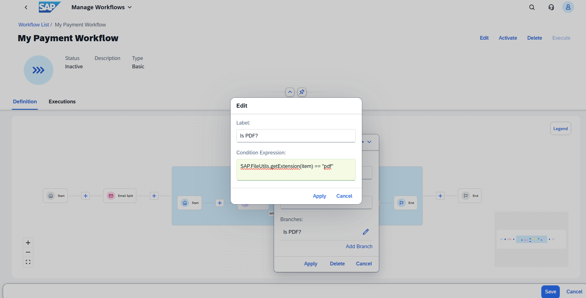

   This branch is taken only for PDF attachments. The **default** branch (for `.txt`, `.xlsx`, `.png`, etc.) leads straight to End, where those files are silently skipped.

## Exercise 4.5 - Add an Extraction Node on the PDF Branch

1. Click the **+** on the **Is PDF?** branch of the Condition and select **Extraction**.

2. Configure the node:

   | Field | Value |
   |---|---|
   | Identifier | `extract_pa` |
   | Wait for Status | **Review Needed** |
   | Schema Version | **PAYMENT_ADVICE_STANDARD v1** |
   | File ID Expression | `item` |

   Click **Apply**.
 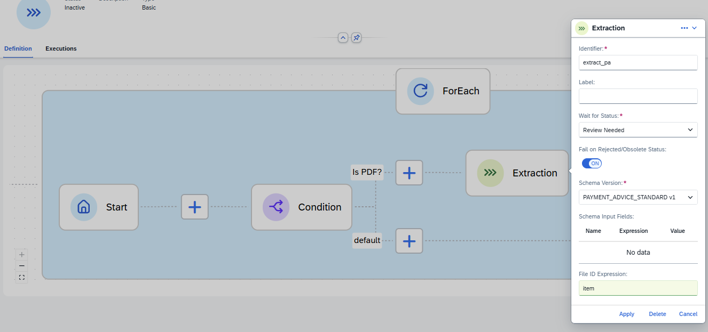

3. Click **Save**, then **Activate** the workflow. The status changes to **Active** and a banner confirms the workflow is now read-only.
 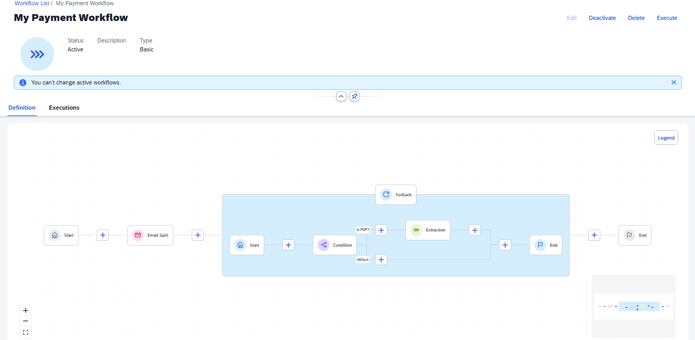

## Exercise 4.6 - Test the Workflow

1. Click **Execute**. In the dialog, click **Browse** and select `payment_advice_acme_jul2026.eml`. Click **Submit**.
 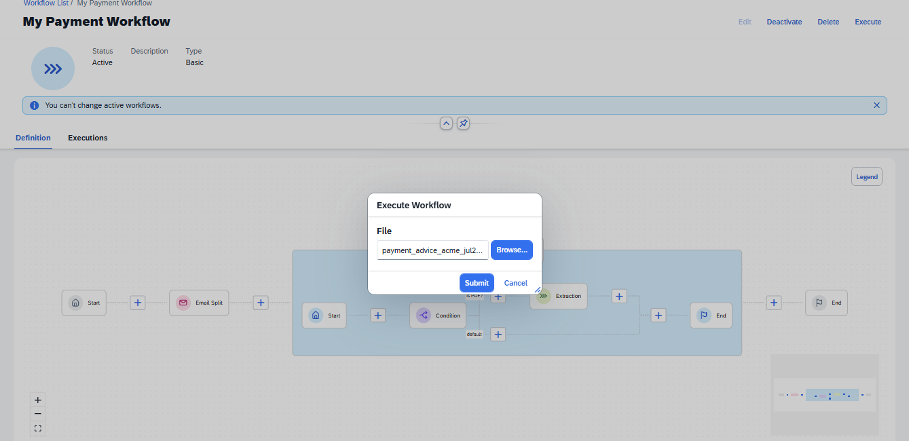

2. Open the **Executions** tab. A new entry appears with status **Started**. Click it to open the execution details.
 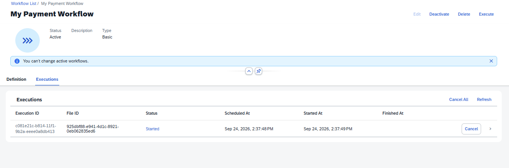

3. The execution trace shows each node (Start, Email Split, ForEach, and End) all marked **Success**. If the workflow is still running, click **Refresh** to get the latest status. The Email Split output shows 4 files processed (the PDF plus the `.txt`, `.xlsx`, and `.png` attachments). The ForEach ran 4 iterations: the PDF one triggered the Extraction, the other three hit the default branch and were skipped.
 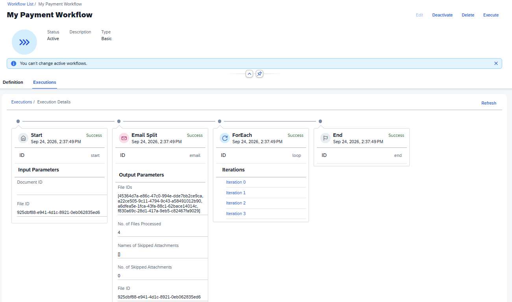

4. Navigate to **Manage Documents** for **PAYMENT_ADVICE_STANDARD**. A new document entry for the PDF attachment should appear. If nothing shows up yet, wait a few seconds and click **Go** again to re-apply the filter.

## Summary

You have built a workflow that handles mixed-attachment emails and extracts only the PDF payment advices. Continue to [Exercise 5](../ex5/README.md) to capture the sender's email address as part of the extraction result.
