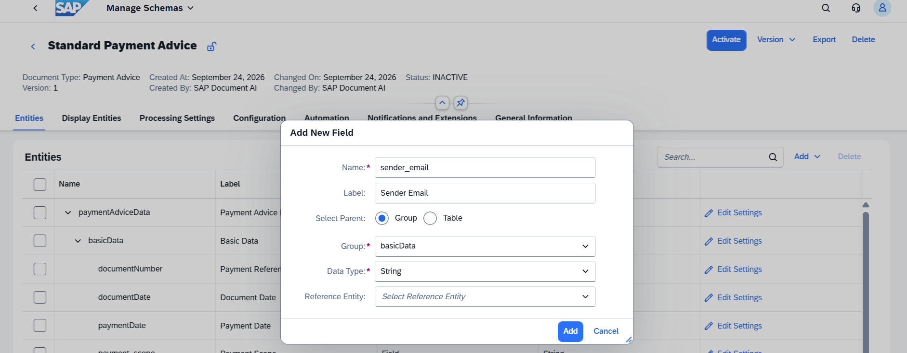
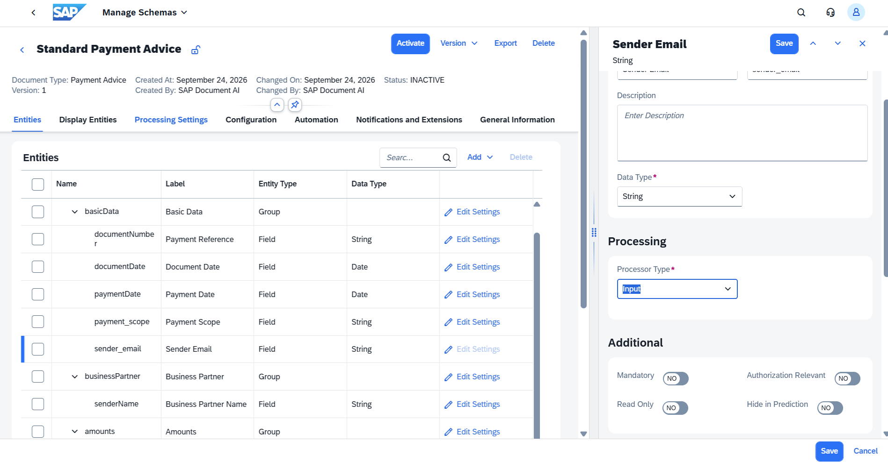
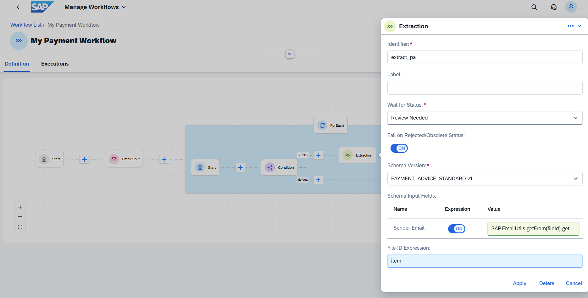
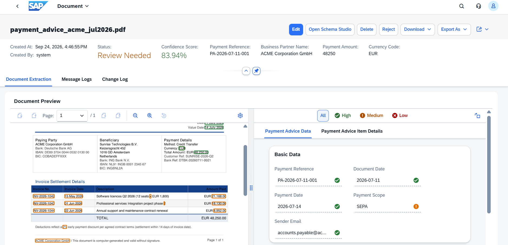

# Exercise 5 - Add an Input Field and Capture Email Metadata

Extracted fields hold values read from the document. Input fields are different: they hold context injected by the caller — a workflow, a channel, or a human uploader — information that is not in the document itself. In this exercise you will add an input field to the schema and use the workflow to write the sender's email address into it automatically.

## Exercise 5.1 - Add an Input Field to the Schema

1. Open **PAYMENT_ADVICE_STANDARD**, Version 1. Click **Deactivate** to make it editable.

2. On the **Entities** tab, click **Add**, then **Add Field**. Fill in the dialog:

   | Field | Value |
   |---|---|
   | Name | `sender_email` |
   | Label | `Sender Email` |
   | Select Parent | **Group** |
   | Group | `basicData` |
   | Data Type | `String` |

   Click **Add**.
<br>

3. The field appears in the entity list. Click **Edit Settings** next to `sender_email`. In the right panel, set **Processor Type** to **Input**.

   The **Input** processor type marks this field as workflow-populated rather than AI-extracted. The model will not attempt to read it from the document. Only a workflow expression can write to it.

   > **Important:** First click **Save** next to the **Sender Email** field to save the field settings, then click **Save** in the lower right to save the schema version.
<br>

4. Click **Activate** to reactivate the schema.

## Exercise 5.2 - Map the Email Sender into the Input Field

1. Open `my_payment_basic` in the Workflows list. Click **Deactivate** to be able to change it.

2. Click the **Extraction** node (`extract_pa`) to open its configuration panel.

3. Under **Schema Input Fields** you will see `Sender Email` listed. Toggle it **ON** and enter the expression:

   ```
   SAP.EmailUtils.getFrom(fileId).getAddress()
   ```

   Click **Apply**, then **Save** and **Activate** the workflow.
<br>

## Exercise 5.3 - Test the Result

1. Click **Execute** and select `payment_advice_acme_jul2026.eml`. Click **Submit**.

2. Once processing completes, open **Manage Documents** and click the resulting document.

3. Find the **Sender Email** field in the **Basic Data** section; it should show `accounts.payable@acme-corp.com`, the sender address from the email envelope, not extracted from the PDF. Notice that **Payment Scope** still shows `SEPA`, inferred purely from the payer and payee country data.
<br>

   This pattern is powerful in production: you can stamp every document with its origin channel, the operator who uploaded it, or any other runtime context that the AI cannot see inside the document.

## Summary

You have added an input field and used a workflow expression to populate it from email metadata. Continue to [Exercise 6](../ex6/README.md) to build a Document Extension workflow that routes high-value payments to a separate approval path.
