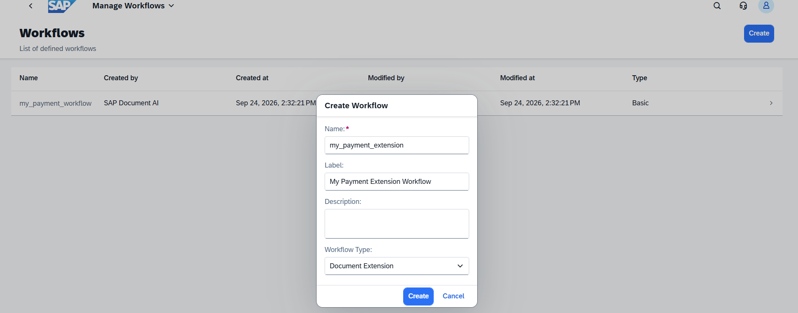
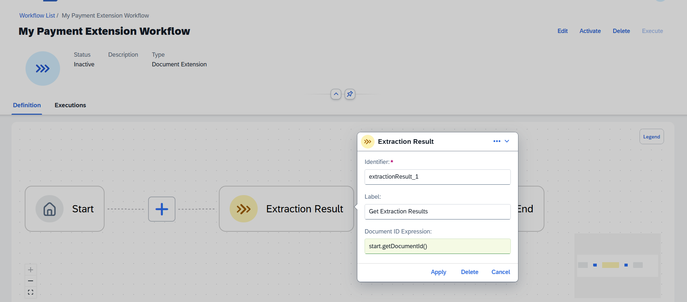
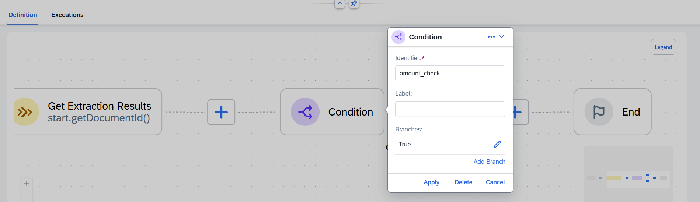
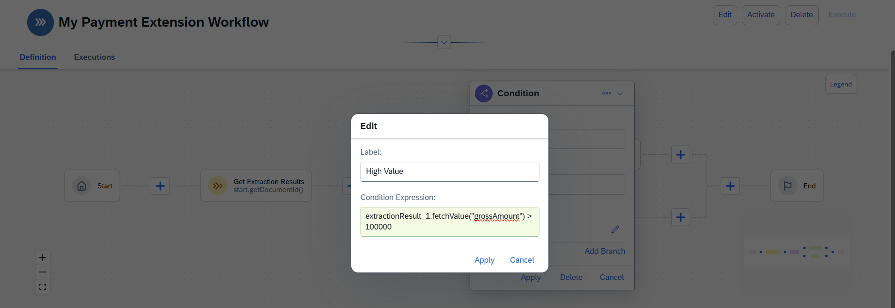
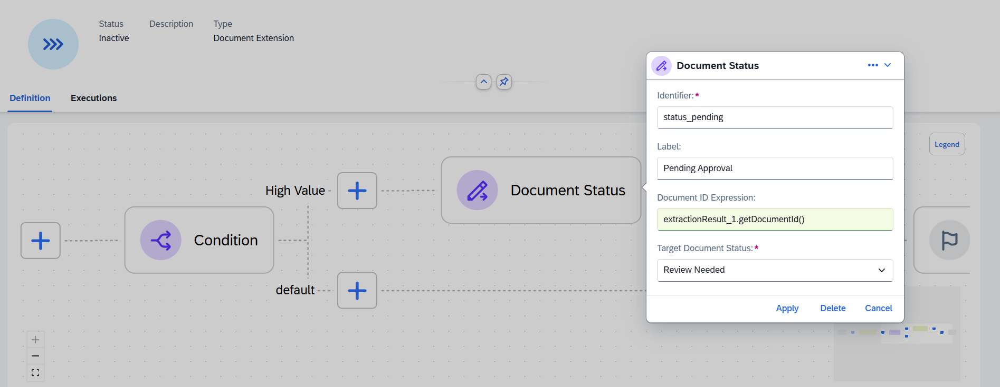
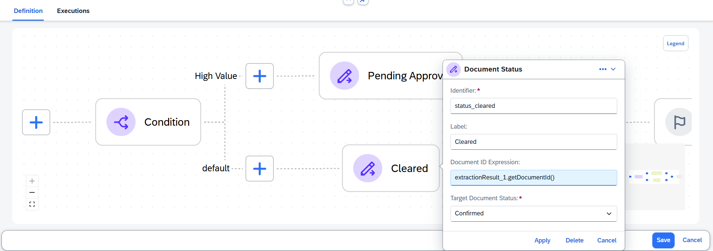
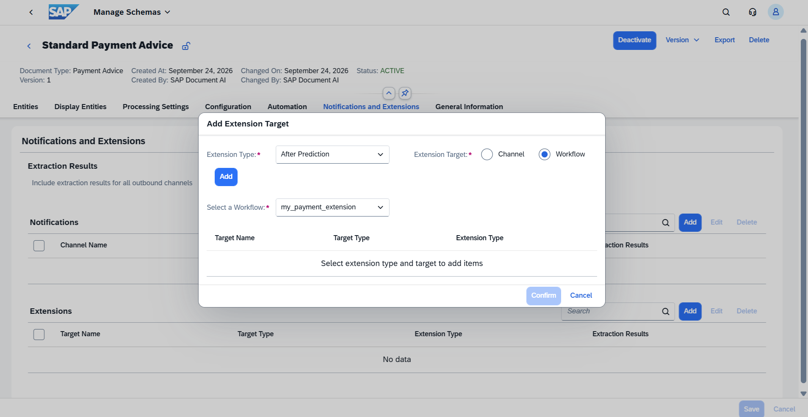
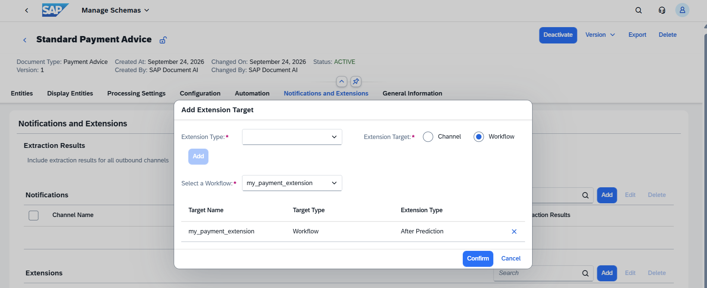
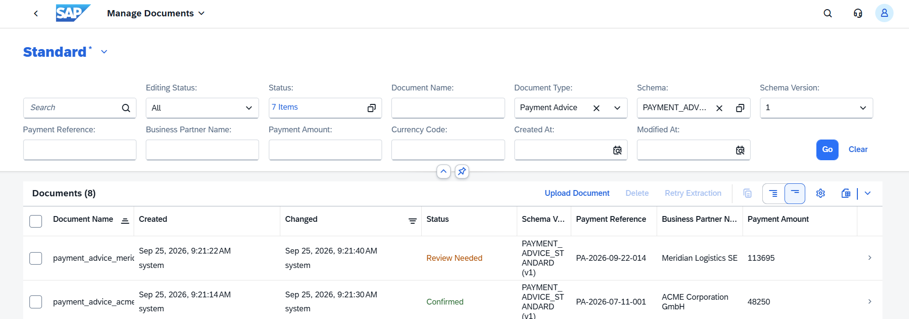

# Exercise 6 - Create a Document Extension Workflow with Value-Based Routing

A Document Extension workflow fires automatically after a document is confirmed. It receives the full extraction result and can act on it: calling an external system, sending a notification, or, as in this exercise, routing the document to different paths based on extracted values.

You will build an extension workflow that checks the gross payment amount: payments above EUR 100,000 are sent back to **Review Needed** for manual review; payments at or below that threshold stay **Confirmed** for straight-through processing.

## Exercise 6.1 - Create the Extension Workflow

1. From the home screen, click **Manage Workflows**, then **Create**.

2. Fill in the dialog:

   | Field | Value |
   |---|---|
   | Name | `my_payment_extension` |
   | Label | `My Payment Extension Workflow` |
   | Workflow Type | **Document Extension** |

   Click **Create**.
 

## Exercise 6.2 - Add an Extraction Result Node

The first node in a Document Extension workflow must be an **Extraction Result** node. It loads the confirmed extraction data so downstream nodes can read field values and the document ID.

1. Click the **+** between Start and End and select **Extraction Result**.

2. Configure:

   | Field | Value |
   |---|---|
   | Identifier | `extractionResult_1` |
   | Label | `Get Extraction Results` |
   | Document ID Expression | `start.getDocumentId()` |

   Click **Apply**.
 

## Exercise 6.3 - Add a Condition for Value-Based Routing

1. Click the **+** after the Extraction Result node and select **Condition**.

2. Set **Identifier** to `amount_check`. Click **Apply**.
 

3. Click the pencil icon next to the **True** branch, then click **Edit** in the context menu. Enter:

   | Field | Value |
   |---|---|
   | Label | `High Value` |
   | Condition Expression | `extractionResult_1.fetchValue("grossAmount") > 100000` |

   Click **Apply**.
 

## Exercise 6.4 - Add Document Status Nodes for Each Branch

**High Value branch (> EUR 100,000):**

1. Click the **+** on the **High Value** branch and select **Document Status**.

2. Configure:

   | Field | Value |
   |---|---|
   | Identifier | `status_pending` |
   | Label | `Pending Approval` |
   | Document ID Expression | `extractionResult_1.getDocumentId()` |
   | Target Document Status | **Review Needed** |

   Click **Apply**.
 

**Default branch (at or below EUR 100,000):**

1. Click the **+** on the **default** branch and select **Document Status**.

2. Configure:

   | Field | Value |
   |---|---|
   | Identifier | `status_cleared` |
   | Label | `Cleared` |
   | Document ID Expression | `extractionResult_1.getDocumentId()` |
   | Target Document Status | **Confirmed** |

   Click **Apply**.
 

3. Click **Save**, then **Activate** the workflow.

## Exercise 6.5 - Link the Extension Workflow to the Schema

The extension workflow only fires if it is registered on the schema. The **Notifications and Extensions** tab is editable while the schema is active, so there is no need to deactivate.

1. Open **PAYMENT_ADVICE_STANDARD**, Version 1. Open the **Notifications and Extensions** tab.

2. In the **Extensions** section, click **Add**. Fill in the dialog:

   | Field | Value |
   |---|---|
   | Extension Type | **After Prediction** |
   | Extension Target | **Workflow** |
   | Select a Workflow | `my_payment_extension` |

   Click **Add**. The workflow appears as a row in the table.
 

3. Click **Confirm**.
 

4. Click **Save**.

## Exercise 6.6 - Test End-to-End

1. Execute `my_payment_basic` with `payment_advice_acme_jul2026.eml` (EUR 48,250, below threshold). Once extracted, confirm the document manually if auto-confirm did not trigger.

2. Execute `my_payment_basic` with `payment_advice_meridian_sep2026.eml` (EUR 113,695, above threshold). Confirm the document.

3. Open **Manage Documents**. The Meridian document should show **Review Needed**: the extension workflow set it back after confirmation. The ACME document should remain **Confirmed**.
 

## Summary

You have built a complete end-to-end document processing pipeline:

| Exercise | What you built |
|---|---|
| 1 | Activated and trimmed PAYMENT_ADVICE_STANDARD, processed a first document |
| 2 | Added a custom `payment_scope` field with AI processing instructions |
| 3 | Enabled automatic confirmation based on confidence thresholds |
| 4 | Built a Basic workflow to process emails with mixed attachments |
| 5 | Captured the sender email address as an input field via workflow expression |
| 6 | Created a Document Extension workflow that routes on extracted value |

From a single email arriving in an inbox, SAP Document AI now: unpacks the attachments, extracts only the PDF payment advices, stamps each with the sender identity, auto-confirms high-confidence results, and immediately routes high-value payments back to review, without any manual intervention.

If you have time left, head over to the [Explore Further](../../README.md#explore-further) exercises to try out vision mode, Instant Learning, or AI-assisted schema generation.
