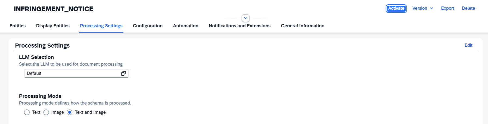
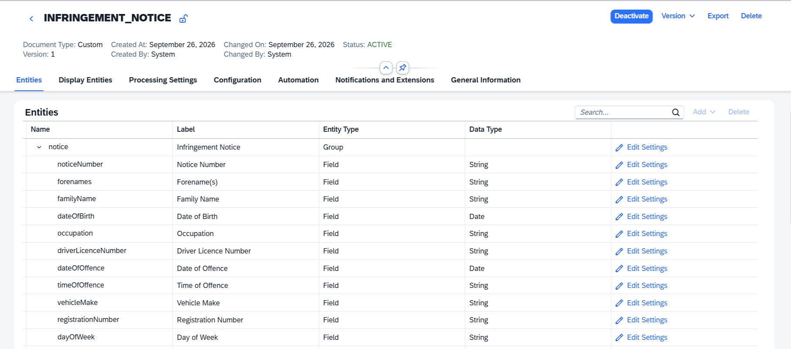
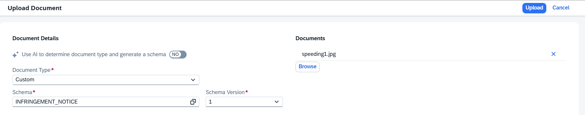

# Explore A - Build a Custom Schema from Scratch with Vision Mode

SAP Document AI ships ready-made schemas for common business documents. For anything non-standard, you create a **custom schema** from scratch and define exactly which fields to extract.

This exercise uses a New Zealand Police Infringement Notice, a handwritten traffic violation form. Because the fields are filled in by hand, vision mode is essential: the model processes each page as an image rather than relying on a text layer, which allows it to read handwritten values accurately.

Vision mode is not limited to handwriting. It also handles any visual element that carries meaning through layout or appearance rather than text: charts, diagrams, tick boxes, and selection fields. This notice is a good example: the day of the week is indicated by a circled letter on a printed row (`S M T W T F S`), not written out as a word. A text-only model sees a row of letters and cannot tell which one is circled. With vision mode, the model reads the page as an image and picks up the circle correctly.

You will create the schema, enable vision mode, define the fields, and test extraction against a sample document.

## A.1 - Create the Schema

1. From the home screen, click **Manage Schemas**, then **Create**.

2. Fill in the dialog:

   | Field | Value |
   |---|---|
   | Name | `INFRINGEMENT_NOTICE` |
   | Document Type | **Custom** |

   Click **Create**.

3. The schema opens on the **Entities** tab with an empty field list. Before adding fields, switch to **Processing Settings**.

## A.2 - Enable Vision Mode

By default, SAP Document AI extracts information from the document's text content. Vision mode adds image processing on top, which helps with handwritten content or other visual elements like charts, checkboxes, and selection fields.

1. On the **Processing Settings** tab, click **Edit**.

2. Set **Processing Mode** to **Text and Image**.
 

3. Click **Save**.

## A.3 - Add Fields

All fields on this document appear once per notice, so no tables are needed.

1. On the **Entities** tab, click **Add**, then **Add Group**. Fill in the dialog:

   | Field | Value                 |
   |---|-----------------------|
   | Name | `notice`              |
   | Label | `Infringement Notice` |

   Click **Add**.

2. **Add Fields** for each row below:

   | Name | Label | Data Type | Mandatory |
   |---|---|---|---|
   | `noticeNumber` | Notice Number | String | Yes |
   | `forenames` | Forename(s) | String | No |
   | `familyName` | Family Name | String | No |
   | `dateOfBirth` | Date of Birth | Date | No |
   | `occupation` | Occupation | String | No |
   | `driverLicenceNumber` | Driver Licence Number | String | No |
   | `dateOfOffence` | Date of Offence | Date | Yes |
   | `timeOfOffence` | Time of Offence | String | No |
   | `vehicleMake` | Vehicle Make | String | No |
   | `registrationNumber` | Registration Number | String | No |
   | `dayOfWeek` | Day of Week | String | No |

3. Click **Save**, then **Activate**. Your entities list should look like this:
 

## A.4 - Test Extraction

1. From the home screen, click **Manage Documents**.

2. Set **Schema** to `INFRINGEMENT_NOTICE` and click **Go**.

3. Click **Upload Document**. In the dialog set:

   | Field | Value |
   |---|---|
   | Document Type | `Custom` |
   | Schema | `INFRINGEMENT_NOTICE` |
   | Schema Version | `1` |

   > **Get the sample image:** Open [https://i.imgur.com/hZg9a3E.jpeg](https://i.imgur.com/hZg9a3E.jpeg) in your browser, right-click the image, and choose **Save image as** to download it. Then select it using **Browse** and click **Upload**.
 

4. Once processing completes, open the document and check the output.

> **Try it:** Go back to **Processing Settings**, switch the mode to **Text** only, re-upload the same image, and compare the results. Most handwritten field values will be missing or incorrect; the difference shows clearly how much the visual signal contributes.

## Why Vision Mode Matters

The infringement notice is filled in by hand. Without vision mode, handwritten values would return empty or garbled results. With **Text and Image** mode, the model reads the rendered page image directly, the same way a human would, and returns accurate structured output without any OCR pre-processing step on your side.
