# Explore B - Improve Extraction Accuracy with Instant Learning

Extracted information is not always perfect. When you review a document and correct a wrong value, you do not want to make the same correction every time. You want the system to learn from it. This is what Instant Learning does: once activated, DocAI remembers corrections you make during review and applies them automatically to the next document processed with the same schema. No retraining, no separate pipeline. The feedback loop is built into the normal review flow.

## B.1 - Import the Bill of Lading Schema

This exercise uses a Bill of Lading schema. Import it from [`BoL_Version_1.json`](BoL_Version_1.json) before continuing.

1. From the home screen, click **Manage Schemas**.
 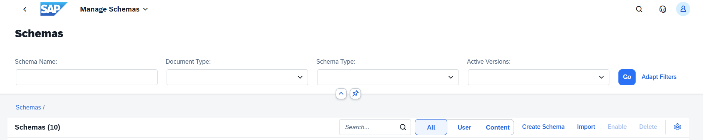

2. Click **Import** and select `BoL_Version_1.json` from the `ex8` folder.
 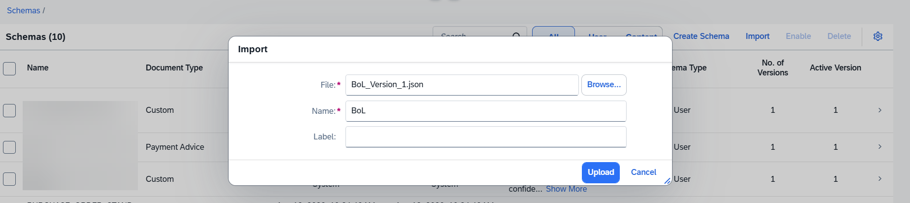

3. Confirm the schema name `BoL` and click **Upload**. The schema appears in the **User** tab with status **Active**.

## B.2 - Enable Instant Learning

1. From the home screen, click **Manage Configurations**.
 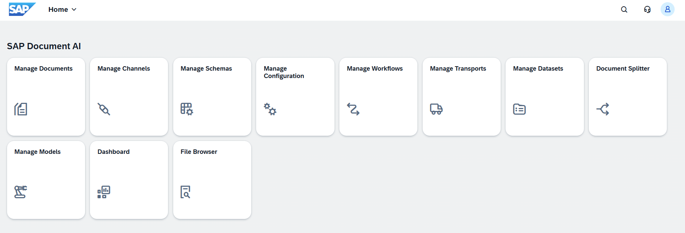

2. Open the **Learning** section, set **Instant Learning** to **Active**, and click **Save**.
 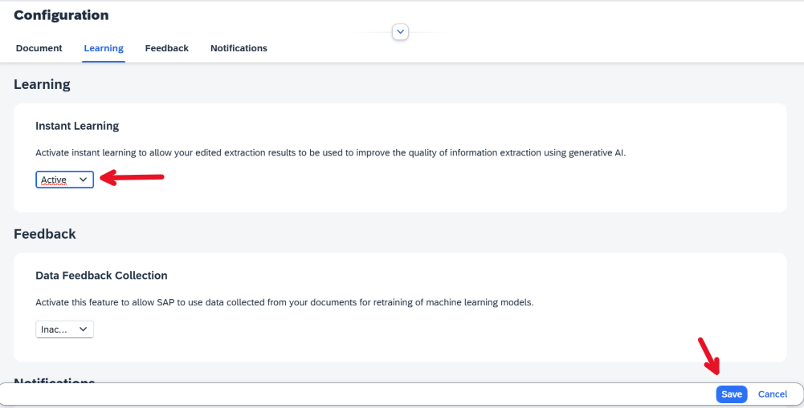

## B.3 - Upload a Document for Review

1. From the home screen, click **Manage Documents**.

2. Set **Document Type** to `Custom`, then set **Schema** to `BoL` and click **Go**.

3. Click **Upload Document** and set:

   | Field | Value |
   |---|---|
   | Document Type | `Custom` |
   | Schema | `BoL` |
   | Schema Version | `1` |

   Select `Bill of Lading 1.pdf` from the `documents` folder, then click **Upload**.

4. Wait until the document reaches **Review Needed** status. Open it.
 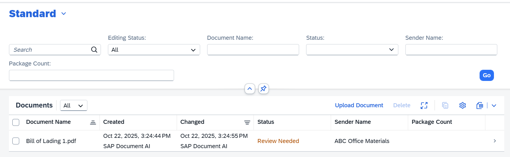

## B.4 - Correct Extraction Errors

1. Click **Edit**.
 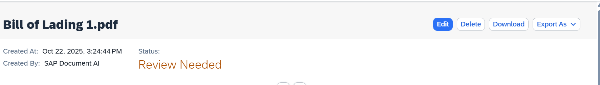

2. Notice that **Package Count** is empty. It should be extracted from the Grand Total section of the document.
 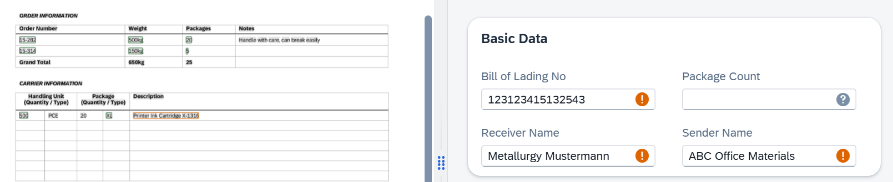

3. Click on the correct value in the document preview, then assign it to the **Package Count** field.
 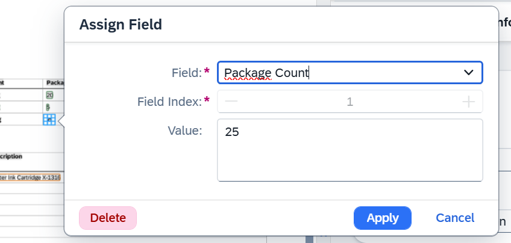

4. Open the **Carrier Information** table. Notice that **Material No** and **Description** are not extracted correctly.
 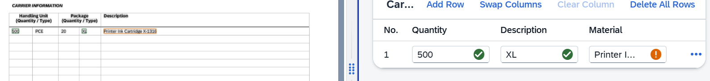

5. Correct both: select `X-1316` as **Material No** and `Printer Ink Cartridge` as **Description**.
 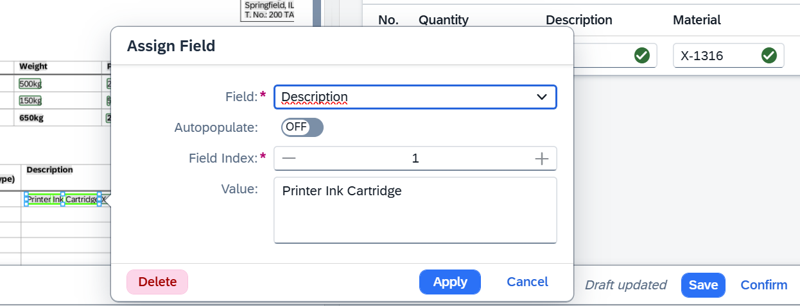

6. Click **Confirm** in the bottom right. A dialog appears. Make sure **Enable instant learning to improve AI accuracy** is checked, then click **Confirm**. Your corrections are now saved as training signal for this schema.
 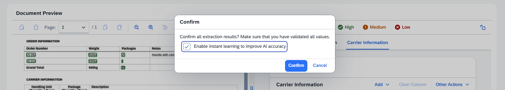

## B.5 - Verify the Learning Effect

1. Re-upload `Bill of Lading 1.pdf` to see the corrections applied. Also upload `Bill of Lading 2 FR.pdf` from the `documents` folder to see the improvement on a different document.

2. Once processing completes, open each document. The fields you corrected in the previous step should now be extracted correctly on both.
 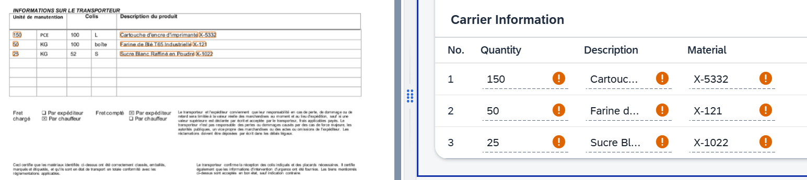
