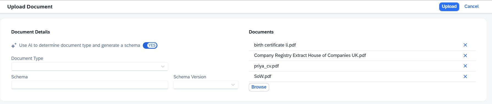
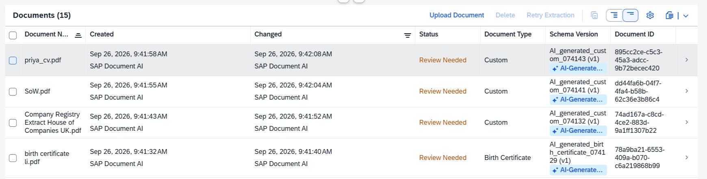

# Explore C - Auto-Generate a Schema by Uploading a Document

Normally, creating a schema means deciding upfront which fields to extract, naming them, setting data types, and configuring groups and tables. For documents you have never modelled before, there is a faster starting point: upload the document and let the AI propose a schema based on what it finds.

This exercise shows how to use the AI-assisted schema generation feature. You will upload a batch of different document types in a single step, and SAP Document AI will create a dedicated schema for each one automatically.

## C.1 - Upload Documents with AI Schema Generation

1. From the home screen, click **Manage Documents**.

2. Click **Upload Document** and select all four sample files from the `documents` folder:
   - `birth certificate li.pdf`
   - `Company Registry Extract House of Companies UK.pdf`
   - `priya_cv.pdf`
   - `SoW.pdf`

3. In the upload dialog, toggle **Use AI to determine document type and generate a schema** to **YES**. Notice that the Document Type, Schema, and Schema Version fields are no longer required; the AI will fill these in.
 

4. Click **Upload**. SAP Document AI will process each file independently, detect its document type, generate a schema, and run extraction, all in one step.

## C.2 - Review the Results

1. Once processing completes, the document list shows all four files with status **Review Needed**. Each document has been assigned its own AI-generated schema.
 

2. All four documents have been assigned an AI-generated schema. Notice that the birth certificate was recognised as **Birth Certificate** and matched to a known document type, while the CV, SoW, and Company Registry extract each got a unique `AI_generated_custom_*` schema created on the fly.

3. Open each document and inspect the extracted fields. The schemas are a starting point: field names, labels, and data types are suggested by the AI based on the document structure, but you can refine them just like any manually created schema.

## What This Is Good For

AI schema generation is useful when you encounter a new document type and want to see what SAP Document AI can extract before investing time in a hand-crafted schema. It is especially practical for one-off documents or rapid prototyping.

For production use, review the generated schema and trim or adjust fields to match exactly what your downstream process needs. Use the **Open Schema Studio** button on the document to review, edit, and save the generated schema directly.
